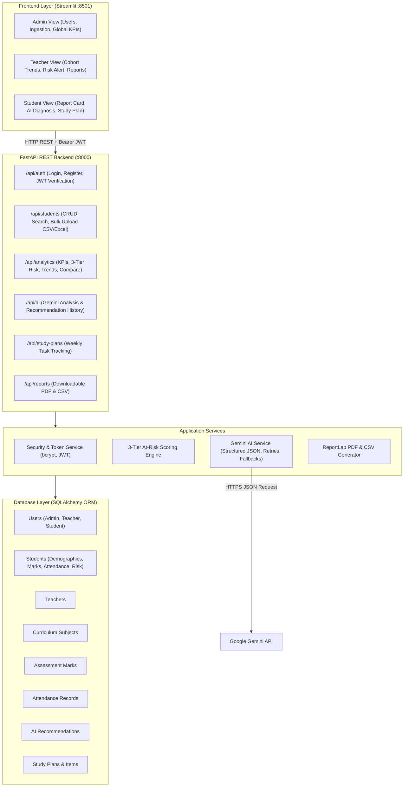
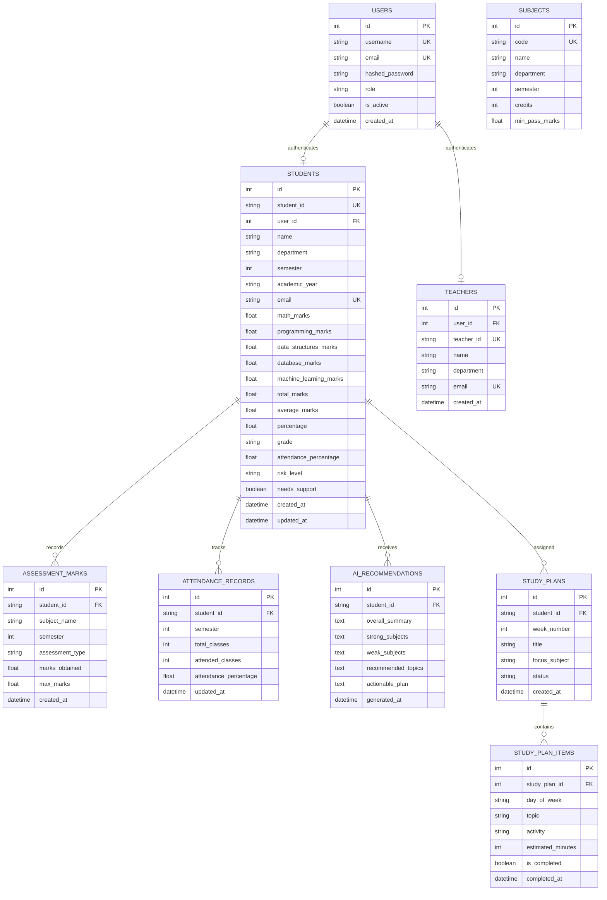

# 🎓 AI-Powered Student Performance Analytics & Recommendation Platform

[](https://www.python.org/)
[](https://fastapi.tiangolo.com/)
[](https://www.sqlalchemy.org/)
[](https://aistudio.google.com/)
[](https://streamlit.io/)
[](https://www.reportlab.com/)
[-brightgreen?logo=pytest)](https://pytest.org/)

An enterprise-ready, AI-powered academic analytics, early intervention, and personalized study planning platform built with **Python**, **FastAPI**, **SQLAlchemy**, **Google Gemini AI**, **Streamlit**, **Plotly**, and **ReportLab**.

---

## 🌟 Core Platform Capabilities

### 1. Multi-Role Authentication & Access Control (RBAC)
- **Role-Based Workspaces**: Dedicated portals for **Admin**, **Teacher**, and **Student** roles.
- **Security Standards**: Cryptographic password hashing using **Bcrypt** and signed **JWT (JSON Web Token)** authorization.
- **Privacy Enforcement**: Student users are isolated and restricted to accessing only their personal academic records.

### 2. Comprehensive Student Management & Bulk Ingestion
- **CRUD Operations**: Complete record creation, update, deletion, and deep-dive inspection.
- **Multi-Criteria Querying**: Substring search by Name or Student ID with real-time filters by **Department**, **Semester**, **Academic Year**, and **Risk Category**.
- **Batch CSV & Excel Ingestion**: High-throughput file upload endpoint (`/api/students/upload`) supporting `.csv`, `.xlsx`, and `.xls` with header normalization, in-batch duplicate detection, and row-level error reporting.
- **Template Generation**: Downloadable sample CSV templates formatted with required column schemas.

### 3. Multi-Factor 3-Tier At-Risk Early Warning Engine
Evaluates academic vulnerability across 4 dimensions:
1. *Aggregate Average*: Penalizes scores $< 50\%$ (failing) and $< 60\%$ (borderline).
2. *Course Failures*: Identifies individual subject cutoffs $< 40.0\%$.
3. *Attendance Deficits*: Flags critical attendance ($< 65\%$) and warning attendance ($< 75\%$).
4. *Temporal Progression*: Detects negative grade trajectories across historical assessment milestones.
- **Categorization**: Classifies students into **Good**, **Needs Attention**, or **At Risk** with explainable 0–100 risk scores, itemized risk drivers, and targeted intervention guidelines.

### 4. Gemini AI Performance Diagnosis & Personalized Study Plans
- **Google Gemini API Integration**: Analyzes actual marks, attendance, and curriculum benchmarks using structured JSON output prompts.
- **Curriculum Gap Analysis**: Calculates subject score gaps and identifies priority syllabus topics for remediation.
- **Resilient Fallback Engine**: If the Gemini API key is omitted, offline, or rate-limited, an intelligent deterministic pedagogical engine executes seamlessly without service disruption.
- **Interactive Weekly Study Planner**: Generates structured 5-day study roadmaps. Students can check off daily tasks in the UI, updating completion percentages in real time.

### 5. Institutional PDF & CSV Reporting
- **Official Student Grade Cards**: High-fidelity PDF report cards generated using ReportLab, complete with institutional seal, marks table, GPA status, and AI diagnostic advice.
- **Faculty At-Risk Dossiers**: Confidential executive PDF reports summarizing flagged students, primary risk drivers, and recommended mentoring actions.
- **Data Exporting**: Instant CSV streaming for cohort records, curriculum course statistics, and historical AI recommendations.

---

## 🏗️ System Architecture



---

## 🗄️ Relational Database Schema (ERD)



---

## ⚡ Quick Start Guide

### 🚀 1-Click Launch (Easiest Method)

Simply double-click:
* **`run_project.bat`** in this project directory, OR
* **`Run Student Analytics.bat`** on your Desktop!

This automatically starts both the FastAPI backend and Streamlit dashboard in parallel and opens your browser.

---

### Manual Launch Method

#### 1. Environment Setup

```powershell
# Navigate to project directory
cd "C:\Users\Trinayasri\OneDrive\Desktop\pojects\student analytics project"

# Activate virtual environment
.\venv\Scripts\Activate.ps1

# (Optional) Set your Gemini API key in terminal or create .env file
$env:GEMINI_API_KEY="your-gemini-api-key-here"
```

#### 2. Database Initialization & Seeding (Pre-seeded)

Reset and seed the SQLite database with 20 diverse synthetic student records and demo user accounts:

```powershell
python seed_data.py --reset
```

##### Pre-Configured Demo Accounts:
| Role | Username | Password | Purpose |
| :--- | :--- | :--- | :--- |
| **Admin** | `admin` | `Admin@123` | Global KPIs, Bulk CSV/Excel Ingestion, User Oversight |
| **Teacher** | `teacher` | `Teacher@123` | Class Progression, 3-Tier Risk Radar, Report Downloads |
| **Student** | `student` | `Student@123` | Personal Grade Card, Gemini AI Diagnosis, Interactive Study Plan |

#### 3. Launch Backend API (Terminal 1)

```powershell
python -m uvicorn app.main:app --host 127.0.0.1 --port 8000 --reload
```
- **API Swagger UI**: [http://127.0.0.1:8000/docs](http://127.0.0.1:8000/docs)
- **Interactive ReDoc**: [http://127.0.0.1:8000/redoc](http://127.0.0.1:8000/redoc)
- **Health Check**: [http://127.0.0.1:8000/health](http://127.0.0.1:8000/health)

#### 4. Launch Frontend Dashboard (Terminal 2)

```powershell
python -m streamlit run frontend/dashboard.py --server.port 8501
```
- Open [http://localhost:8501](http://localhost:8501) in your browser.
- Use the **1-Click Demo Login** buttons to immediately explore any role.

---

## 🧪 Comprehensive Automated Testing

The project includes **49 automated integration and unit tests** executed using Pytest against an isolated in-memory SQLite database:

```powershell
.\venv\Scripts\python.exe -m pytest -v
```

### Test Suite Summary:
```
============================= test session starts =============================
collected 49 items

tests/test_ai_and_study_plans.py .....                                   [ 10%]
tests/test_analytics_api.py ..                                           [ 14%]
tests/test_auth.py .........                                             [ 32%]
tests/test_bulk_upload_and_filters.py .......                            [ 46%]
tests/test_crud.py .....                                                 [ 57%]
tests/test_reports.py ......                                             [ 69%]
tests/test_risk_and_analytics.py ......                                  [ 81%]
tests/test_students_api.py .........                                     [100%]

============================= 49 passed in 11.54s =============================
```

---

## 📡 Complete REST API Endpoint Directory

### Authentication (`/api/auth`)
| Method | Endpoint | Description | Access |
| :--- | :--- | :--- | :--- |
| `POST` | `/api/auth/register` | Register new user account | Public |
| `POST` | `/api/auth/login` | Authenticate with JSON payload, returns JWT | Public |
| `POST` | `/api/auth/token` | OAuth2 password flow endpoint for Swagger UI | Public |
| `GET` | `/api/auth/me` | Retrieve authenticated user profile | Bearer Token |

### Student Management (`/api/students`)
| Method | Endpoint | Description | Access |
| :--- | :--- | :--- | :--- |
| `POST` | `/api/students/` | Create single student record | Admin / Teacher |
| `GET` | `/api/students/` | List students (pagination, search, dept, sem, year, risk filters) | Authenticated |
| `GET` | `/api/students/{id}` | Get individual student details and computed metrics | Authenticated (Isolated) |
| `PUT` | `/api/students/{id}` | Update student demographics or marks | Admin / Teacher |
| `DELETE` | `/api/students/{id}` | Remove student record | Admin / Teacher |
| `GET` | `/api/students/departments` | List distinct departments | Public |
| `GET` | `/api/students/academic-years` | List distinct academic year sessions | Public |
| `GET` | `/api/students/template/csv` | Download sample student CSV import template | Public |
| `POST` | `/api/students/upload` | Bulk upload CSV or Excel (`.xlsx`, `.xls`) file | Admin / Teacher |

### Academic Analytics (`/api/analytics`)
| Method | Endpoint | Description | Access |
| :--- | :--- | :--- | :--- |
| `GET` | `/api/analytics/summary` | Overall college KPIs, pass percentage, risk counts | Public |
| `GET` | `/api/analytics/departments` | Department-wise enrollment and average breakdown | Public |
| `GET` | `/api/analytics/grade-distribution`| Count and percentage across letter grades ($A+$ to $F$) | Public |
| `GET` | `/api/analytics/subject-averages` | Average, highest, and lowest scores per course | Public |
| `GET` | `/api/analytics/at-risk` | Legacy at-risk student list | Authenticated |
| `GET` | `/api/analytics/risk-evaluations` | 3-tier risk evaluation with risk score, factors & recommendations | Authenticated |
| `POST` | `/api/analytics/compare` | Side-by-side comparison matrix for 2–10 students | Authenticated |
| `GET` | `/api/analytics/compare/{id}` | Benchmark student against department class average | Authenticated |
| `GET` | `/api/analytics/trends` | Semester progression dynamics (Semesters 1 to 8) | Public |
| `GET` | `/api/analytics/attendance-insights`| Pearson correlation coefficient ($r$) & attendance tiers | Public |
| `GET` | `/api/analytics/rankings` | Top and lowest performing student rankings | Authenticated |

### AI Diagnostics (`/api/ai`)
| Method | Endpoint | Description | Access |
| :--- | :--- | :--- | :--- |
| `POST` | `/api/ai/analyze/{id}` | Generate Gemini AI diagnosis & 5-day study plan | Authenticated (Isolated) |
| `GET` | `/api/ai/history/{id}` | Retrieve historical AI recommendations | Authenticated (Isolated) |

### Personalized Study Plans (`/api/study-plans`)
| Method | Endpoint | Description | Access |
| :--- | :--- | :--- | :--- |
| `GET` | `/api/study-plans/{id}` | Retrieve active study plan and task items | Authenticated (Isolated) |
| `PATCH`| `/api/study-plans/items/{id}/toggle`| Toggle task item completion status and update progress % | Authenticated (Isolated) |
| `POST` | `/api/study-plans/generate/{id}` | Re-generate fresh weekly roadmap | Authenticated (Isolated) |

### Reporting & Exports (`/api/reports`)
| Method | Endpoint | Description | Access |
| :--- | :--- | :--- | :--- |
| `GET` | `/api/reports/student/{id}/pdf` | Download official certified student PDF report card | Authenticated (Isolated) |
| `GET` | `/api/reports/at-risk/pdf` | Download institutional at-risk PDF dossier | Admin / Teacher |
| `GET` | `/api/reports/class/csv` | Download cohort student records as CSV | Admin / Teacher |
| `GET` | `/api/reports/subject-analytics/csv`| Download course-level analytics as CSV | Admin / Teacher |
| `GET` | `/api/reports/ai-recommendations/csv`| Download AI recommendation history as CSV | Admin / Teacher |

---

## 💼 Technical Interview Preparation Highlights

1. **Architectural Separation**: The FastAPI backend is entirely stateless and exposes self-documenting REST APIs. The presentation layer (Streamlit) interacts strictly over HTTP via standard Bearer tokens, adhering to the Single Responsibility Principle.
2. **Defensive AI Engineering**: LLM integration uses structured JSON decoding schema configurations with strict Pydantic parsing. When cloud connectivity is degraded or the API key is omitted, an automated pedagogical fallback engine deterministically analyzes student marks, ensuring the platform maintains a 100% SLA.
3. **Multi-Factor Risk Modeling**: Replaced naive single-cutoff logic with an explainable 4-dimensional engine evaluating aggregate marks, individual subject thresholds, attendance minimums, and longitudinal score trajectories.
4. **Memory-Safe File Streaming**: Large file uploads are handled via `UploadFile` (spooled disk buffering), while report card PDFs are compiled in-memory via ReportLab `io.BytesIO` streams, eliminating disk race conditions and temporary file sprawl.
5. **Data Protection & RBAC**: Password storage utilizes salted `bcrypt` hashes. Role-Based Access Control dependencies enforce strict student record isolation, preventing unauthorized cross-student data exposure.

---

## 📜 License & Compliance

This platform is developed exclusively using synthetic, anonymized demonstration data for educational, research, and placement evaluation purposes.
