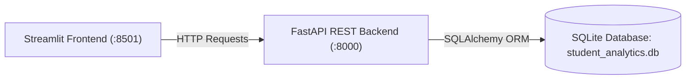
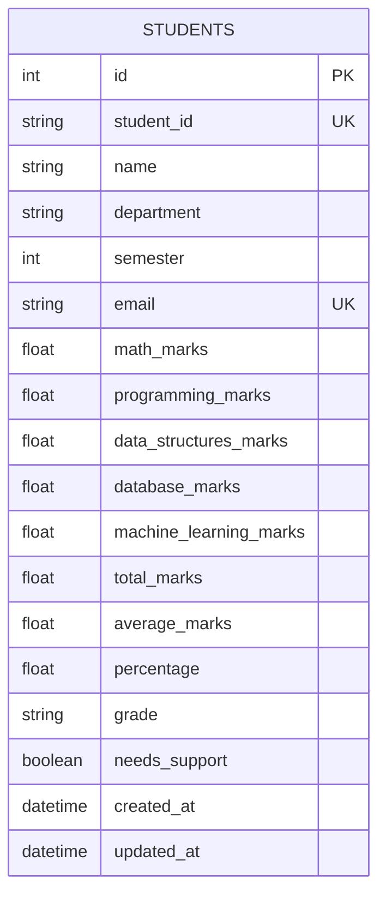

# 🎓 Student Performance Analytics System

A production-structured, beginner-friendly academic record management and performance analytics web platform built with **FastAPI**, **SQLAlchemy**, **SQLite**, **Pydantic**, **Streamlit**, and **Plotly**. Designed for learning, project presentation, and technical placement interviews.

---

## 🌟 Key Features

- **Decoupled Architecture**: Presentation layer (Streamlit) interacts strictly with the backend (FastAPI) via standard REST APIs.
- **Academic Record Management**: Complete CRUD operations with pagination, real-time substring search, and multi-criteria filtering.
- **Automated Performance Analytics**: Auto-computes total marks, percentage, letter grades ($A+, A, B, C, D, F$), and early-intervention support status.
- **Support & At-Risk Alerting**: Flags students requiring counseling based on aggregate average $< 50\%$ or individual subject marks $< 40\%$.
- **Interactive Visualizations**: High-performance Plotly charts for department benchmarking, grade distributions, and subject dynamics.
- **Automated Test Suite**: 16 Pytest integration & unit tests running against an isolated in-memory SQLite database in under 1 second.
- **Self-Documenting API**: Interactive OpenAPI Swagger documentation auto-generated at `/docs`.

---

## 🏗️ Architecture & ER Diagram





---

## 🚀 Quick Start Guide

### Step 1: Clone & Setup Virtual Environment

```powershell
# Open terminal in the project directory
cd "C:\Users\Trinayasri\OneDrive\Desktop\pojects\student analytics project"

# Create virtual environment
python -m venv venv

# Install project dependencies
.\venv\Scripts\pip install -r requirements.txt
```

### Step 2: Seed Demonstration Data

Populate the database with 20 synthetic student records across 5 engineering departments:

```powershell
.\venv\Scripts\python seed_data.py --reset
```

### Step 3: Start the FastAPI Backend (Terminal 1)

In your first terminal, launch the backend REST API:

```powershell
.\venv\Scripts\uvicorn app.main:app --host 127.0.0.1 --port 8000 --reload
```

- API Base URL: `http://127.0.0.1:8000`
- Interactive Swagger UI: `http://127.0.0.1:8000/docs`
- Health check: `http://127.0.0.1:8000/health`

### Step 4: Start the Streamlit Frontend (Terminal 2)

Open a **second terminal** in the project directory and launch the dashboard:

```powershell
cd "C:\Users\Trinayasri\OneDrive\Desktop\pojects\student analytics project"
.\venv\Scripts\streamlit run frontend/dashboard.py --server.port 8501
```

The dashboard will open automatically in your browser at:
`http://localhost:8501`

---

## 🧪 Running Automated Tests

Run the full Pytest test suite:

```powershell
.\venv\Scripts\pytest -v
```

All 16 tests execute in ~0.8s against an isolated in-memory test database.

---

## 📡 Sample API Requests

### 1. Create a Student
```bash
curl -X POST "http://127.0.0.1:8000/api/students/" \
     -H "Content-Type: application/json" \
     -d '{
       "student_id": "STU2050",
       "name": "Rohan Deshpande",
       "department": "Artificial Intelligence & Machine Learning",
       "semester": 6,
       "email": "rohan.deshpande@university.edu",
       "math_marks": 88.0,
       "programming_marks": 92.0,
       "data_structures_marks": 85.0,
       "database_marks": 89.0,
       "machine_learning_marks": 94.0
     }'
```

### 2. Get Department Performance Breakdown
```bash
curl "http://127.0.0.1:8000/api/analytics/departments"
```

### 3. Get At-Risk Students
```bash
curl "http://127.0.0.1:8000/api/analytics/at-risk"
```

---

## 📚 Complete Documentation Index

All in-depth documentation guides are available in the [`docs/`](docs/) directory:

1. [Project Overview](docs/PROJECT_OVERVIEW.md) — Problem statement, functional capabilities, and project boundaries.
2. [System Architecture](docs/ARCHITECTURE.md) — Architectural patterns, request flow, and Mermaid sequence diagrams.
3. [Database Guide](docs/DATABASE_GUIDE.md) — Tables, column definitions, stored metrics rationale, and raw SQL equivalents.
4. [REST API Guide](docs/API_GUIDE.md) — Comprehensive endpoint catalogue, schemas, status codes, and cURL requests.
5. [Python Concepts](docs/PYTHON_CONCEPTS.md) — Deep dive into type hints, generators, context managers, and OOP patterns used.
6. [IBM Placement Interview Questions](docs/INTERVIEW_QUESTIONS.md) — 42 interview questions with direct, simple answers.
7. [Code Walkthrough](docs/CODE_WALKTHROUGH.md) — Detailed explanation of every file and function.
8. [Testing Guide](docs/TESTING_GUIDE.md) — Automated testing architecture and 16-point manual verification checklist.
9. [Limitations & Future Improvements](docs/LIMITATIONS_AND_IMPROVEMENTS.md) — Production scaling roadmap (PostgreSQL, JWT, Redis).
