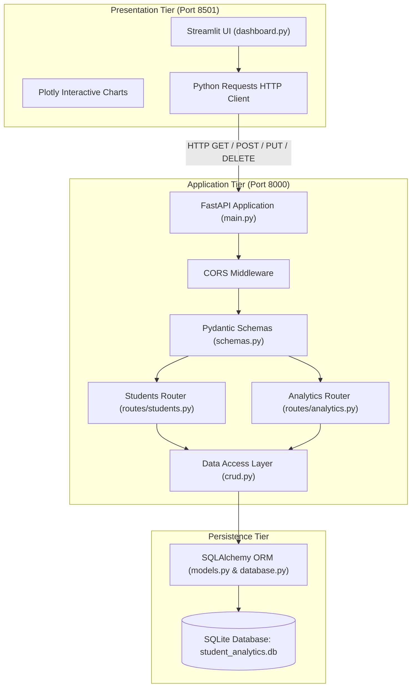
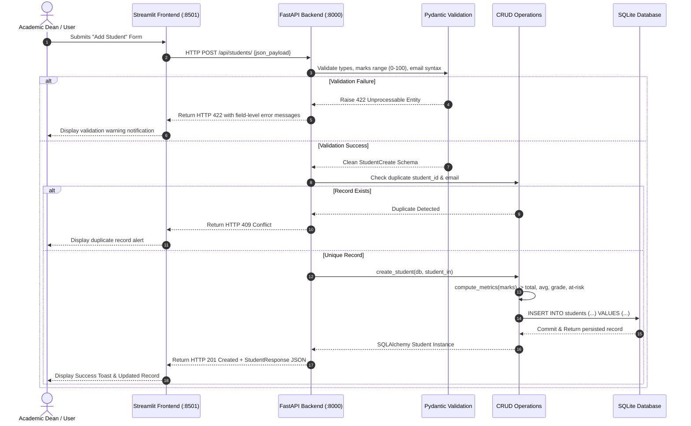

# System Architecture & Technical Flow

## 1. Architectural Philosophy: Decoupled Multi-Tier Architecture

The **Student Performance Analytics System** follows an industry-standard **Three-Tier Decoupled Architecture**:

1. **Presentation Tier (Frontend)**: Streamlit interactive web dashboard utilizing Plotly for data visualization.
2. **Application Tier (Backend REST API)**: FastAPI micro-framework executing request validation (Pydantic), business logic, routing, and CORS policy enforcement.
3. **Data Tier (Persistence)**: SQLite database queried via SQLAlchemy Object-Relational Mapping (ORM) with session pooling.

---

## 2. Request & Response Execution Flow

When a user performs an action in the frontend (such as adding a student or requesting department analytics), the end-to-end execution flow proceeds through distinct isolation boundaries:

---

## 3. Why Frontend Does Not Directly Touch The Database

In many novice student projects, Streamlit connects directly to SQLite (`sqlite3.connect`). In this project, direct database queries from the frontend are strictly prohibited. 

**Why Decoupling is Crucial (Key IBM Placement Discussion Point):**
1. **Security**: The database credentials, schema internals, and query logic are encapsulated behind the API gateway. The presentation layer never has direct SQL execution privileges.
2. **Reusability & Omnichannel Access**: The exact same FastAPI endpoints can power a Streamlit dashboard, a React web client, an iOS/Android mobile application, or a partner university microservice.
3. **Independent Scalability**: In a production environment, the backend API can be horizontally scaled across multiple container instances (e.g., Kubernetes / Docker) behind a load balancer, while frontend static assets are served independently.
4. **Single Source of Truth for Business Logic**: Metric calculation rules, grading cutoffs, and at-risk thresholds exist solely in the backend business layer, eliminating duplicate client-side logic.

---

## 4. Key Design Patterns Utilized

- **Dependency Injection**: FastAPI's `Depends(get_db)` manages the database session lifecycle, automatically creating and closing connections per request without global state pollution.
- **Repository / Data Access Pattern**: All raw SQL/ORM query logic is encapsulated in `app/crud.py`, keeping route handlers lightweight and focused strictly on HTTP protocol concerns.
- **Data Transfer Object (DTO) Pattern**: Pydantic schemas (`StudentCreate`, `StudentResponse`, `PaginatedStudentResponse`) act as strongly-typed DTOs that decouple internal database representations from external network responses.
