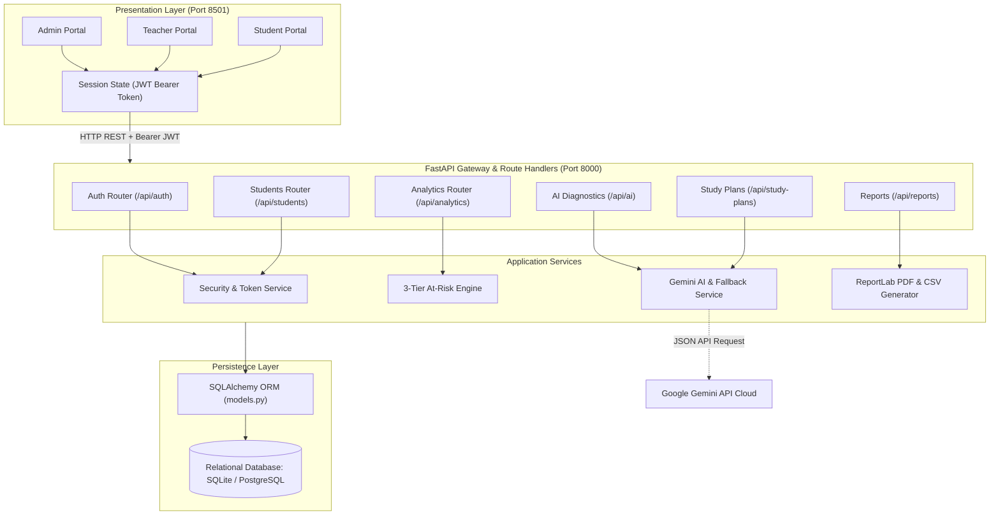
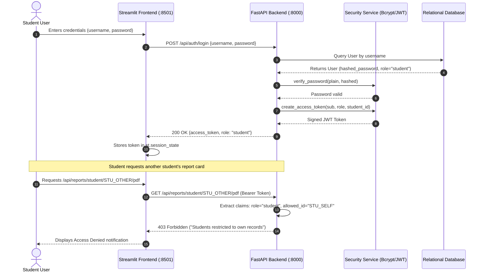
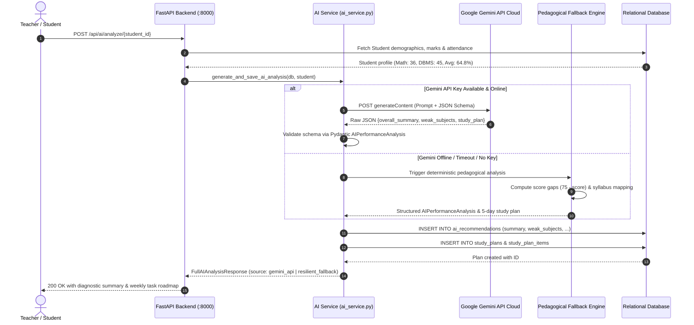
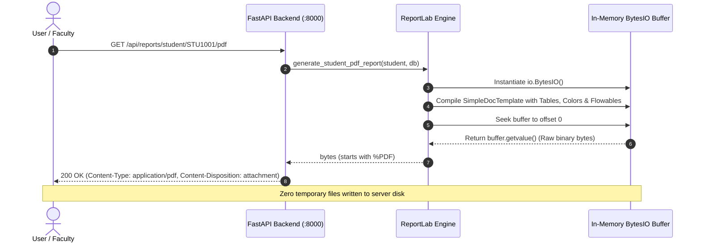

# 🏛️ System Architecture & Technical Specifications

## 1. Architectural Philosophy: Decoupled Multi-Tier Platform

The **AI-Powered Student Performance Analytics Platform** follows an industry-standard **N-Tier Decoupled Architecture**:

1. **Presentation Tier (Frontend)**: Streamlit interactive multi-role web platform utilizing Plotly for dynamic charts and WebSocket-backed session state management.
2. **API Gateway & Routing Tier (Backend REST API)**: FastAPI framework handling request routing, JWT validation, RBAC enforcement, and CORS policy management.
3. **Service & Intelligence Tier (Business Logic)**:
   - `Security Service`: Bcrypt password hashing & JWT token lifecycle management.
   - `3-Tier Risk Engine`: Multi-factor 4D academic risk evaluation.
   - `AI Diagnostic Service`: Google Gemini API client with Pydantic validation & deterministic fallback.
   - `Reporting Service`: In-memory ReportLab PDF compilation and CSV streaming.
4. **Data Persistence Tier (ORM & Database)**: Relational schema managed by SQLAlchemy ORM supporting both SQLite (development) and PostgreSQL (production).

---

## 2. Technical Sequence Workflows

### Workflow A: Role-Based Authentication & Self-Access Isolation

---

### Workflow B: Gemini AI Diagnosis with Resilient Fallback

---

### Workflow C: In-Memory PDF Streaming Architecture

