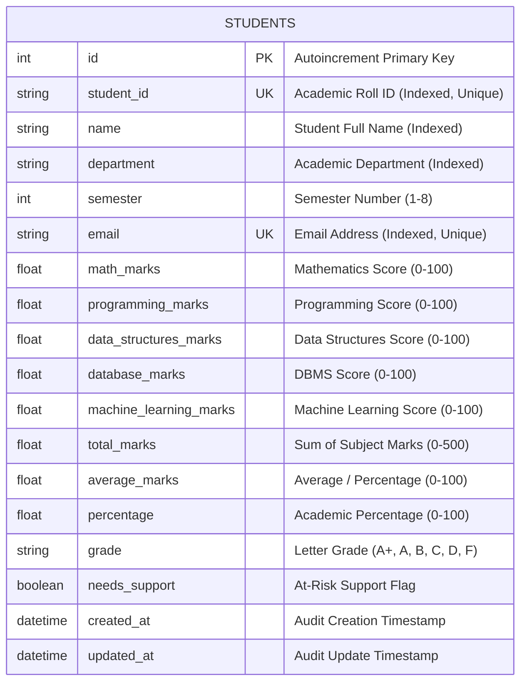

# Database Design & Operations Guide

## 1. Entity-Relationship (ER) Overview

The persistence layer uses a normalized relational schema within SQLite. It stores student demographic records, course evaluations across 5 subjects, and pre-computed analytical metrics.



---

## 2. Table Schema Specification: `students`

| Column Name | SQL Type | Nullable | Constraints / Index | Purpose |
|---|---|---|---|---|
| `id` | `INTEGER` | NO | `PRIMARY KEY AUTOINCREMENT` | Internal database surrogate key. |
| `student_id` | `VARCHAR(30)` | NO | `UNIQUE`, `INDEXED` | Unique institutional registration roll code (e.g., `STU1001`). |
| `name` | `VARCHAR(100)` | NO | `INDEXED` | Student's full official name; indexed for fast substring search. |
| `department` | `VARCHAR(100)` | NO | `INDEXED` | Academic branch; indexed for fast department-level filtering. |
| `semester` | `INTEGER` | NO | `INDEXED` | Current enrolled semester (bounded between 1 and 8). |
| `email` | `VARCHAR(150)` | NO | `UNIQUE`, `INDEXED` | Unique institutional email address for communication. |
| `math_marks` | `FLOAT` | NO | Default: `0.0` | Evaluated score in Mathematics ($0.0 \le \text{mark} \le 100.0$). |
| `programming_marks` | `FLOAT` | NO | Default: `0.0` | Evaluated score in Programming / Python. |
| `data_structures_marks` | `FLOAT` | NO | Default: `0.0` | Evaluated score in Data Structures & Algorithms. |
| `database_marks` | `FLOAT` | NO | Default: `0.0` | Evaluated score in Database Systems. |
| `machine_learning_marks` | `FLOAT` | NO | Default: `0.0` | Evaluated score in Machine Learning. |
| `total_marks` | `FLOAT` | NO | Pre-computed | Sum of all 5 course marks (maximum 500.0). |
| `average_marks` | `FLOAT` | NO | Pre-computed, `INDEXED` | Average percentage score ($0.0 - 100.0\%$). |
| `percentage` | `FLOAT` | NO | Pre-computed | Equal to overall average percentage. |
| `grade` | `VARCHAR(5)` | NO | Pre-computed, `INDEXED` | Assigned tier: `A+`, `A`, `B`, `C`, `D`, `F`. |
| `needs_support` | `BOOLEAN` | NO | Pre-computed, `INDEXED` | Early warning flag: `True` if average $< 50$ or any mark $< 40$. |
| `created_at` | `DATETIME` | NO | Default: UTC timestamp | Audit trail timestamp for record creation. |
| `updated_at` | `DATETIME` | NO | Default: UTC timestamp | Audit trail timestamp for last modification. |

---

## 3. Stored vs Computed Columns: Design Rationale

A common question in technical interviews:
> *"Why did you store `total_marks`, `average_marks`, `grade`, and `needs_support` in the table rather than computing them on-the-fly during every query?"*

### Trade-Off Analysis
1. **On-the-fly Computation**:
   - *Pros*: Saves a few bytes of storage.
   - *Cons*: Every time a department summary, sort by average, or grade distribution query is executed, the database must perform arithmetic operations across every row in the table ($O(N)$ CPU overhead).
2. **Pre-computed Storage (Write-Time Computation)**:
   - *Pros*: **Read-Heavy Optimization**. Educational portals are read 99% of the time (viewing dashboards, generating transcripts) and updated infrequently. Storing the derived columns enables indexed, $O(1)$ read lookups and native database aggregates (`AVG(average_marks)`, `GROUP BY grade`).
   - *Data Integrity Guarantee*: The `create_student` and `update_student` functions in `crud.py` automatically recompute these fields before committing transactions, ensuring data integrity.

---

## 4. Connection Pooling & SQLite Concurrency

In `app/database.py`, the engine is instantiated as:
```python
connect_args = {"check_same_thread": False}
engine = create_engine(DATABASE_URL, connect_args=connect_args)
SessionLocal = sessionmaker(autocommit=False, autoflush=False, bind=engine)
```

- **`check_same_thread=False`**: By default, Python's SQLite driver only allows the thread that created the connection to execute queries. FastAPI processes multiple asynchronous requests across thread pools. Setting this flag allows different request threads to communicate with SQLite safely.
- **Transactional Sessions (`get_db`)**: Each request receives an isolated `SessionLocal` generator object via FastAPI's `Depends(get_db)`. `db.commit()` commits the transaction, and `db.close()` in the `finally` block guarantees that connection resources are recycled.

---

## 5. Equivalent Raw SQL Queries

The SQLAlchemy ORM translates python expressions into parameterized SQL queries. Here are the equivalent raw SQL statements executed by the system:

### 1. Department Summary Aggregate
```sql
SELECT 
    department,
    COUNT(id) AS student_count,
    ROUND(AVG(average_marks), 2) AS average_marks,
    MAX(average_marks) AS highest_marks,
    MIN(average_marks) AS lowest_marks
FROM students
GROUP BY department
ORDER BY average_marks DESC;
```

### 2. Identifying At-Risk Students
```sql
SELECT student_id, name, department, average_marks, grade
FROM students
WHERE needs_support = 1
ORDER BY average_marks ASC;
```

### 3. Case-Insensitive Pagination & Substring Search
```sql
SELECT * FROM students
WHERE (name LIKE '%Sharma%' OR student_id LIKE '%Sharma%')
  AND department = 'Computer Science & Engineering'
ORDER BY student_id ASC
LIMIT 10 OFFSET 0;
```
