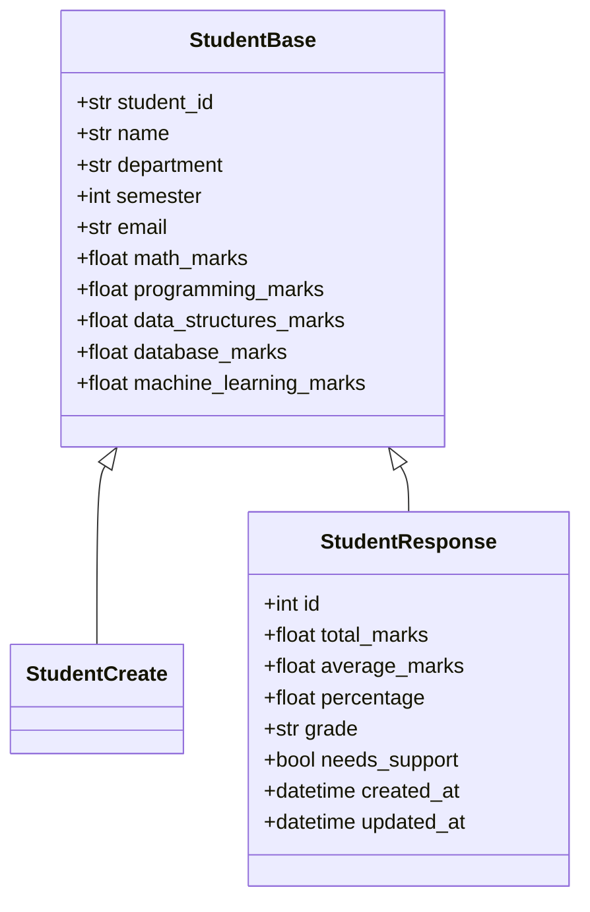

# Core Python Concepts Utilized in This Project

This guide provides deep technical explanations of the core Python concepts and language features implemented across the **Student Performance Analytics System**. Study this thoroughly for technical interviews.

---

## 1. Type Hints & Static Typing (`typing` module)

Python is dynamically typed, but modern software engineering emphasizes type annotations (PEP 484) to improve IDE autocompletion, enable static analysis (MyPy), and power runtime validation (Pydantic).

### In Our Code:
```python
from typing import Optional, List, Tuple, Generator
from sqlalchemy.orm import Session

def get_students(
    db: Session,
    skip: int = 0,
    limit: int = 10,
    search: Optional[str] = None,
    department: Optional[str] = None,
    semester: Optional[int] = None
) -> Tuple[List[Student], int]:
```
- `Optional[str]` is equivalent to `Union[str, None]`, signaling that `search` may either be a string or `None`.
- `Tuple[List[Student], int]` specifies that the function returns exactly two items: a list of `Student` objects and an integer count.
- `Generator[Session, None, None]` indicates a generator yielding a database `Session`.

---

## 2. Generators & Memory-Safe Resource Cleanup (`yield`)

A generator is a function that produces a sequence of results over time using the `yield` keyword instead of returning a single value with `return`.

### In Our Code (`app/database.py`):
```python
def get_db() -> Generator[Session, None, None]:
    db = SessionLocal()
    try:
        yield db
    finally:
        db.close()
```

### Interview Explanation:
When FastAPI processes a request, it calls `get_db()`. Execution pauses at `yield db`, providing the database session to the route. Once the route finishes processing and sends its HTTP response, execution resumes immediately in the `finally:` block, executing `db.close()`. This guarantees that **database connections are never leaked**, even if an unhandled exception occurred during request execution.

---

## 3. Asynchronous Context Managers (`@asynccontextmanager`)

Context managers manage resource allocation and cleanup using the `with` statement (or `async with` for coroutines).

### In Our Code (`app/main.py`):
```python
@asynccontextmanager
async def lifespan(app: FastAPI):
    # Startup event: create tables
    Base.metadata.create_all(bind=engine)
    yield
    # Shutdown event: executes when application stops
```

### Interview Explanation:
FastAPI deprecated the older `@app.on_event("startup")` syntax in favor of Python's standard `lifespan` context manager. Code before `yield` executes once during server startup; code after `yield` executes upon server shutdown.

---

## 4. Python Decorators (`@`)

A decorator is a design pattern in Python that allows you to modify or extend the behavior of a function or method without altering its source code. Decorators wrap another function.

### In Our Code:
- `@router.get("/summary")`: Registers the handler with FastAPI's routing table, mapping the HTTP `GET` verb and URI to the Python function.
- `@field_validator("name", "student_id")`: Pydantic decorator that intercepts input fields to sanitize whitespace before parsing.
- `@pytest.fixture(scope="function")`: Injects setup/teardown test dependencies before each test run.

---

## 5. Object-Oriented Programming (OOP) & Inheritance

The project leverages OOP principles to eliminate code duplication:

### Model Inheritance in Pydantic:


- **Inheritance**: `StudentCreate` and `StudentResponse` inherit common demographic and mark fields from `StudentBase`, ensuring the DRY (*Don't Repeat Yourself*) principle.
- **Encapsulation**: The `Student` SQLAlchemy model encapsulates business logic with its `recalculate_metrics()` method.

---

## 6. Dictionary & Keyword Argument Unpacking (`**kwargs`)

The `**` operator unpackages dictionary key-value pairs into named function arguments.

### In Our Code (`seed_data.py`):
```python
for item in DEMONSTRATION_STUDENTS:
    student_schema = StudentCreate(**item)
```
Instead of manually typing `StudentCreate(student_id=item["student_id"], name=item["name"], ...)`, `**item` passes each dictionary key as a matching keyword argument directly to the constructor.

---

## 7. List Comprehensions & Higher-Order Query Mapping

List comprehensions provide a concise and performant syntax for transforming sequences.

### In Our Code (`app/crud.py`):
```python
return [
    {
        "department": row.department,
        "student_count": row.student_count,
        "average_marks": round(float(row.average_marks), 2),
        "highest_marks": round(float(row.highest_marks), 2),
        "lowest_marks": round(float(row.lowest_marks), 2)
    }
    for row in results
]
```
This is faster and more readable in Python than creating an empty list and calling `.append()` inside a traditional `for` loop.

---

## 8. Robust Exception Handling (`try...except...finally`)

Exception handling guarantees application resilience under failure conditions.

### In Our Code (`frontend/dashboard.py`):
```python
try:
    response = requests.get(url, params=params, timeout=5)
    response.raise_for_status()
    return response.json(), None
except requests.exceptions.ConnectionError:
    return None, "Backend API is unreachable."
except requests.exceptions.HTTPError as e:
    return None, f"HTTP {response.status_code}: {detail}"
except Exception as e:
    return None, str(e)
```
By catching specific exception classes (`ConnectionError`, `HTTPError`) before the fallback `Exception`, the frontend handles network drops gracefully without crashing the user interface.
